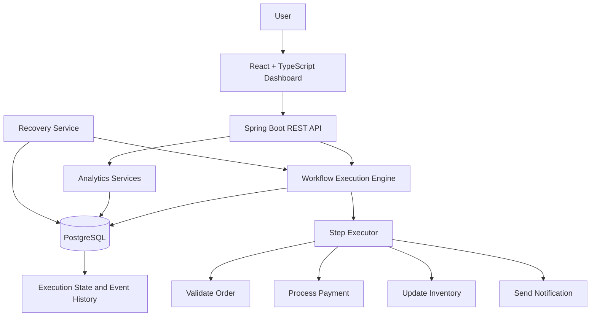
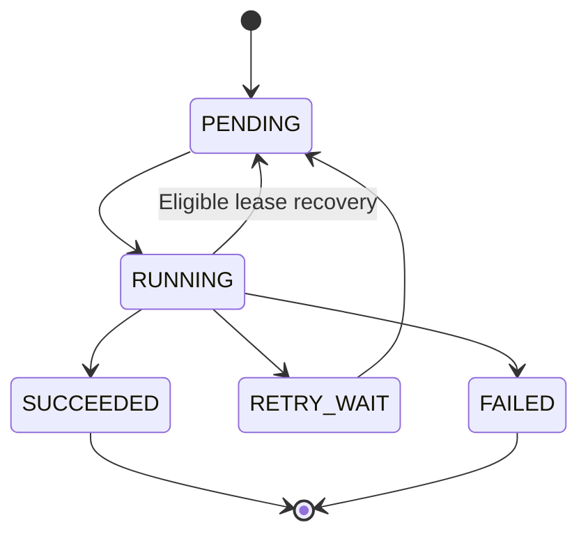

# FlowGuard — Crash-Proof Workflow Engine

**A durable workflow execution engine built with Java, Spring Boot, and PostgreSQL, featuring persistent execution state, retry scheduling, crash recovery, idempotency safeguards, and explainable statistical anomaly detection.**

FlowGuard explores a fundamental backend engineering problem: **what happens when a workflow fails halfway through execution?**

Instead of relying on in-memory task state, FlowGuard persists workflow and step execution data in PostgreSQL. It is designed to resume interrupted work, manage retryable failures, record execution history, and expose operational insights through a React dashboard and REST API.

> **Project focus:** Backend engineering, durable execution, fault recovery, database coordination, API design, and production-oriented system design.

---

## Table of Contents

- [Overview](#overview)
- [Why FlowGuard?](#why-flowguard)
- [Key Features](#key-features)
- [Architecture](#architecture)
- [Workflow Lifecycle](#workflow-lifecycle)
- [Execution Analytics](#execution-analytics)
- [Technology Stack](#technology-stack)
- [API Reference](#api-reference)
- [Database Design](#database-design)
- [Project Structure](#project-structure)
- [Getting Started](#getting-started)
- [Configuration](#configuration)
- [Failure Handling and Design Decisions](#failure-handling-and-design-decisions)
- [Current Limitations](#current-limitations)
- [Manual Verification Checklist](#manual-verification-checklist)
- [Future Improvements](#future-improvements)
- [Author](#author)

---

## Overview

FlowGuard is a custom workflow engine that coordinates multi-step business operations while keeping execution state durable and observable.

Consider an order-processing workflow:

1. Validate the order.
2. Process payment.
3. Update inventory.
4. Send a notification.

If the backend stops after a step begins, an in-memory-only implementation may lose track of the operation or require manual intervention. FlowGuard instead persists execution state, records step transitions, and uses recovery mechanisms to identify work that may need to resume.

The project combines a custom Java backend with a PostgreSQL persistence layer, a REST API, and a React dashboard for inspecting executions and their statistical diagnostics.

**The goal is not just to execute tasks, but to make their state, failures, retries, and recovery behavior explicit.**

## Why FlowGuard?

Traditional background-task implementations can become difficult to reason about when failures, retries, concurrent workers, and application restarts occur together.

FlowGuard focuses on these engineering challenges:

- How can workflow progress survive a backend restart?
- How can workers coordinate when multiple execution attempts compete for the same step?
- How should retryable failures differ from permanent failures?
- How can interrupted work be recovered without blindly repeating every completed step?
- How can execution history help operators understand unusual behavior?

The project addresses these concerns through persisted execution records, conditional database claims, retry scheduling, recovery logic, idempotency safeguards, and explainable analytics.

## Key Features

### Durable workflow execution

- Persisted workflow and step execution state.
- PostgreSQL-backed execution history and lifecycle events.
- Explicit step-level status tracking.
- Recovery mechanisms for interrupted or expired worker leases.

### Retry and failure management

- Configurable retry behavior for eligible failures.
- Exponential backoff with jitter.
- Persistent retry-wait state.
- Error classification to distinguish transient failures from permanent failures.
- Attempt counters and execution diagnostics.

### Concurrency safeguards

- Atomic conditional database claims for step execution.
- Database-backed coordination to reduce the risk of multiple workers claiming the same step.
- Worker lease handling and recovery sweeps.
- Batch repository queries for analytics over execution history.

### Idempotency safeguards

- Idempotency keys and payload-hash validation.
- Protection against reusing an idempotency key with a different request payload.
- Deterministic identifiers for payment-step operations.

**Important:** Exactly-once external side effects cannot be guaranteed by a local database transaction alone. An external payment provider must support and enforce the supplied idempotency key for that protection to extend across the external-system boundary.

### Execution observability

- Persisted execution-event history.
- Step status and retry visibility.
- REST endpoints for workflow execution and analytics.
- Statistical anomaly diagnostics with contributing features and reason codes.
- A dashboard for reviewing execution health and unusual behavior.

### Explainable statistical analysis

- Historical execution baselines.
- Mean, sample standard deviation, median, and interquartile range (IQR).
- Anomaly scores and severity categories.
- Explicit insufficient-data handling.
- Retry eligibility and policy-based risk assessments.

FlowGuard's analytics are based on statistical rules and historical execution data. They are **not a trained machine-learning model**.

---

## Architecture



### Main backend components

| Component | Responsibility |
|---|---|
| Workflow engine | Coordinates the execution of workflow steps. |
| Step executor | Runs individual workflow operations. |
| Retry service | Applies retry eligibility and backoff policies. |
| Recovery service | Finds and handles eligible interrupted work. |
| Repositories | Persist and retrieve execution, step, and event data. |
| Analytics services | Extract features, calculate baselines, and assess anomalies. |
| REST controllers | Expose workflow and analytics operations. |
| React dashboard | Presents workflow state and execution diagnostics. |

The architecture is intentionally built around a custom workflow engine rather than delegating orchestration to a prebuilt workflow platform.

## Workflow Lifecycle

A typical step progresses through states such as:



The exact transitions depend on the configured retry policy and recovery conditions.

### Example: Handling a transient failure

1. A worker claims a pending step.
2. The engine persists the step's running state and lease information.
3. The operation encounters a retryable failure.
4. The engine records the failure and schedules a retry according to the configured backoff policy.
5. An eligible retry becomes available for execution.
6. The engine records the subsequent result in the execution history.

### Example: Recovering interrupted work

If a worker stops unexpectedly while a step is running, the recovery mechanism can inspect persisted state and lease information. Once recovery conditions are met, the step can be reclaimed for processing.

Recovery must account for the possibility that an external side effect succeeded immediately before the worker crashed. Deterministic idempotency identifiers help only when the external operation also enforces deduplication.

---

## Execution Analytics

FlowGuard includes a backend analytics module under `com.flowguard.analytics`.

Rather than generating arbitrary client-side predictions, it derives execution features from persisted records and evaluates them against a historical statistical baseline.

### Baseline metrics

| Metric | Purpose |
|---|---|
| Mean | Average observed value. |
| Sample standard deviation | Measures variation in historical observations. |
| Median | Represents the middle value in sorted observations. |
| Interquartile range | Measures the spread of the middle 50% of observations. |
| Retry statistics | Help identify unusual retry behavior. |
| Recovery statistics | Summarize historical recovery outcomes when sufficient observations exist. |

### Anomaly assessment

The detector combines selected execution signals, including duration, retries, failures, incidents, and available payload amounts, into a bounded anomaly score.

The resulting assessment can include:

- Anomaly score and severity.
- Analysis status.
- Reason codes explaining unusual behavior.
- Observed features and baseline comparisons.
- Retry eligibility and attempts remaining.
- Recommended backoff delay.
- A human-readable explanation.

### Insufficient-data behavior

A statistical baseline needs enough historical observations to be meaningful. When the available sample is too small, the analysis can return `INSUFFICIENT_DATA` rather than treating the absence of a calibrated baseline as evidence of an anomaly.

Zero-variance and missing-value cases also require explicit handling to avoid misleading statistical scores.

**Interpretation:** These diagnostics are heuristic operational signals. They should not be interpreted as validated predictive probabilities or proof that a future execution will fail.

### Analytics playground

The simulation endpoint evaluates hypothetical inputs against the current baseline in memory. Simulation requests are intended to remain separate from persisted production execution history.

---

## Technology Stack

| Layer | Technologies |
|---|---|
| Language | Java 21 |
| Backend framework | Spring Boot 3.x |
| API | REST, JSON |
| Persistence | Spring Data JPA, Hibernate |
| Database | PostgreSQL |
| Schema management | Flyway |
| Validation | Jakarta Bean Validation |
| Monitoring | Spring Boot Actuator |
| Frontend | React, TypeScript, Vite |
| Web serving | Nginx |
| Containers | Docker, Docker Compose |
| Backend testing tools | JUnit, Mockito |
| Integration testing option | Testcontainers |

The presence of a dependency does not imply every test or integration path has been exercised. See the manual verification checklist before relying on runtime behavior.

---

## API Reference

The following endpoints describe the implemented analytics interface. Confirm request formats and response DTOs against the source code before integrating external clients.

| Method | Endpoint | Purpose |
|---|---|---|
| `GET` | `/api/analytics/executions/{id}` | Analyze a specific execution. |
| `GET` | `/api/analytics/recent?limit=20` | Retrieve recent execution assessments. |
| `GET` | `/api/analytics/summary` | Retrieve aggregate analytics and baseline information. |
| `POST` | `/api/analytics/simulate` | Evaluate hypothetical inputs in memory. |
| `GET` | `/api/executions/{id}/anomaly` | Convenience endpoint for execution anomaly analysis. |

### Example: Retrieve an execution assessment

```http
GET /api/analytics/executions/{executionId}
```

The response may contain fields such as:

```json
{
  "executionId": "YOUR_EXECUTION_UUID",
  "anomalyScore": 0.0,
  "isAnomaly": false,
  "severity": "LOW",
  "status": "INSUFFICIENT_DATA",
  "modelType": "STATISTICAL_DISTRIBUTION_ANALYSIS",
  "reasonCodes": [],
  "contributingFeatures": [],
  "explanation": "Insufficient historical data for a calibrated statistical assessment."
}
```

This is an illustrative response shape, not a captured runtime response. Use the actual DTO definitions as the source of truth.

### Example: Run an analytics simulation

```http
POST /api/analytics/simulate
Content-Type: application/json

{
  "amount": 1200.00,
  "attemptCount": 2,
  "errorType": "504 Gateway Timeout"
}
```

The response is intended to include a statistical assessment and policy-based retry information. Exact values depend on the current historical baseline and configured retry policy.

### Interactive API documentation

If the OpenAPI/Swagger UI dependency and configuration are enabled, the local documentation may be available at:

`http://localhost:8080/swagger-ui/index.html`

Check the actual route for the configured OpenAPI dependency and version.

---

## Database Design

FlowGuard uses PostgreSQL to persist workflow state and execution history.

The existing persistence model includes tables for:

- `workflow_definitions` — workflow definitions.
- `workflow_executions` — individual workflow runs.
- `step_executions` — per-step execution state and attempts.
- `execution_events` — lifecycle and diagnostic events.
- `idempotency_records` — request idempotency information.

The analytics module derives its baseline from execution data rather than requiring a separate preloaded training dataset.

Batch repository lookups are used to reduce repeated step and event queries during historical analysis.

Schema changes and additional Flyway migrations should be documented when introduced; the current implementation report states that the analytics additions require no new schema migration.

---

## Project Structure

```text
FlowGuard/
├── src/
│   └── main/
│       ├── java/com/flowguard/
│       │   ├── analytics/
│       │   │   ├── controller/
│       │   │   ├── model/
│       │   │   └── service/
│       │   ├── config/
│       │   ├── controller/
│       │   ├── repository/
│       │   └── ...
│       └── resources/
│           ├── application.yml
│           └── db/migration/
├── frontend/
│   ├── src/
│   │   ├── components/
│   │   ├── services/
│   │   ├── types/
│   │   └── App.tsx
│   ├── Dockerfile
│   └── nginx.conf
├── compose.yaml
├── .env.example
├── mvnw
└── README.md
```

This is a conceptual overview. Actual package and directory names may differ; keep the tree aligned with the repository.

---

## Getting Started

### Prerequisites

For the containerized setup:

- Docker Desktop or Docker Engine with Docker Compose.
- A cloned copy of the repository.

For local development:

- Java 21.
- Node.js 20 or compatible.
- npm.
- PostgreSQL, or a configured development database supported by the project.

### 1. Clone the repository

```bash
git clone <YOUR_GITHUB_REPOSITORY_URL>
cd FlowGuard
```

Replace the placeholder with the repository's actual URL.

### 2. Configure environment variables

Create a local environment file from the example:

```bash
cp .env.example .env
```

On Windows Command Prompt:

```bat
copy .env.example .env
```

Review the variables before starting the application. Set the database password and allowed frontend origins according to your local setup.

Do not commit `.env` or production credentials to Git.

### 3. Start the full stack with Docker Compose

```bash
docker compose up -d --build
```

Check the container status:

```bash
docker compose ps
```

View backend logs:

```bash
docker compose logs -f backend
```

Stop the stack:

```bash
docker compose down
```

The expected local dashboard URL for the documented Compose configuration is:

`http://localhost:3000`

The backend API is expected at:

`http://localhost:8080`

These URLs depend on the actual Compose port mappings.

### 4. Run the backend locally

From the repository root on Windows:

```powershell
.\mvnw.cmd spring-boot:run
```

On macOS or Linux:

```bash
./mvnw spring-boot:run
```

Ensure the database configuration matches the active Spring profile and that the database is available.

### 5. Run the frontend locally

In a separate terminal:

```bash
cd frontend
npm install
npm run dev
```

Vite normally prints the actual local development URL. Use that URL rather than assuming it will always use port `3000`.

Configure `VITE_API_BASE_URL` according to the frontend's API client and development setup. Vite environment variables are applied at build/start time, so restart the dev server after changing them.

---

## Configuration

Important configuration areas include:

| Setting | Purpose |
|---|---|
| `SPRING_DATASOURCE_URL` | Database connection URL. |
| `SPRING_DATASOURCE_USERNAME` | Database username. |
| `SPRING_DATASOURCE_PASSWORD` | Database password. |
| `flowguard.cors.allowed-origins` | Allowed browser origins. |
| `VITE_API_BASE_URL` | Frontend API base URL, where required by the API client. |

For containerized deployment, the browser should call an address reachable from the browser, while Nginx can forward API requests internally to the backend container.

A hostname such as `backend` is normally resolvable inside the Compose network, not directly by the user's browser.

Use separate development and production configuration. Production must not rely on a predictable default database password.

---

## Failure Handling and Design Decisions

### PostgreSQL-backed state

Workflow and step state are persisted so recovery decisions can be based on durable records rather than only in-memory objects.

### Conditional step claims

Database-level conditional updates help coordinate workers competing to claim eligible steps. Correctness still depends on transaction boundaries, lease conditions, and how failures are handled.

### Exponential backoff

Retry delays increase with successive attempts, subject to the configured maximum and jitter policy. The analytics layer reports policy-based recommendations; the workflow engine remains responsible for actual scheduling.

### Idempotency boundaries

Idempotency records and payload hashes help detect duplicate requests and conflicting reuse of an idempotency key. They do not automatically guarantee that every arbitrary external operation executes exactly once.

### Queue saturation

Executor rejection behavior must preserve a recoverable path for work that has already been persisted. A rejection log alone is not a durability guarantee; queue saturation and recovery behavior should be verified during manual testing.

### Honest analytics

Statistical rules provide interpretable diagnostics, not a substitute for a trained model, a production monitoring evaluation, or a proven failure-prediction system.

---

## Current Limitations

FlowGuard is an engineering project, and some capabilities remain intentionally limited.

- **External payment integration:** The payment operation is simulated unless a real provider integration has been added separately.
- **External side-effect guarantees:** Exactly-once effects require compatible idempotency support from external providers.
- **Authentication:** The demonstrated client-side account-switching experience is not equivalent to server-enforced authentication or multi-tenant authorization.
- **Distributed coordination:** Database claims and leases coordinate execution, but large multi-instance deployments need careful validation of polling, contention, and recovery behavior.
- **Statistical validation:** Anomaly thresholds and weights are heuristics that require evaluation against real execution history.
- **Runtime verification:** Do not treat source-level implementation or documentation as proof that builds, tests, deployment, or recovery scenarios succeed.

These limitations define useful next steps rather than hiding important engineering trade-offs.

---

## Manual Verification Checklist

Before considering the system ready for a demonstration or deployment, verify the following in your own environment.

- [ ] Application starts with the intended database and profile.
- [ ] A normal workflow executes all expected steps.
- [ ] Execution and step states persist in PostgreSQL.
- [ ] Duplicate idempotency keys are handled correctly.
- [ ] Reusing an idempotency key with a different payload returns the expected conflict.
- [ ] Retryable errors transition through the expected retry state.
- [ ] Permanent failures do not retry indefinitely.
- [ ] An interrupted worker can be recovered after its lease expires.
- [ ] Concurrent workers cannot both successfully claim the same step.
- [ ] Queue saturation does not silently strand persisted work.
- [ ] Analytics distinguish insufficient history from normal evaluated results.
- [ ] Simulation requests do not alter production execution history.
- [ ] Frontend analytics show API failures clearly rather than presenting stale results as live.
- [ ] CORS rejects unapproved origins.
- [ ] Unexpected server errors do not expose stack traces or database details.
- [ ] Docker Compose networking and frontend API proxying work as intended.

Completing this checklist requires actual tests; it is not a claim that the items have already passed.

---

## Future Improvements

Potential next steps include:

1. Add comprehensive unit and integration tests for retries, lease recovery, idempotency, and concurrent worker contention.
2. Exercise the persistence layer against PostgreSQL in integration tests.
3. Add backend-enforced authentication and authorization.
4. Introduce metrics and structured observability for worker health, queue saturation, retry volume, and recovery latency.
5. Evaluate anomaly thresholds against labeled execution data and measure false-positive rates.
6. Add provider-backed payment idempotency if a real payment integration is introduced.
7. Validate multi-instance recovery and polling behavior under realistic load.
8. Expand operational documentation with verified deployment and troubleshooting procedures.

---

## Author

**Aditya Yadav**

- GitHub: [github.com/adityayadvv45](https://github.com/adityayadvv45)
- LinkedIn: [linkedin.com/in/aditya-yadav-289b132b3](https://www.linkedin.com/in/aditya-yadav-289b132b3)
- Portfolio: [aditya-portfolio-8zfw.vercel.app](https://aditya-portfolio-8zfw.vercel.app)

---

*FlowGuard is a portfolio engineering project focused on durable workflow execution, fault recovery, retry semantics, database coordination, and explainable execution analytics.*